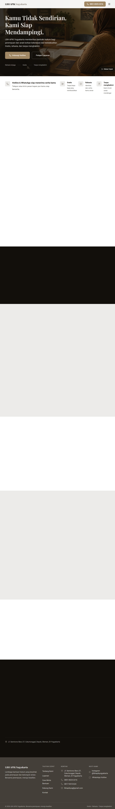

# LBH APIK Yogyakarta — Sahabat Hukum Perempuan dan Anak

Website LBH APIK Yogyakarta, lembaga bantuan hukum yang mendampingi perempuan
dan anak korban kekerasan serta ketidakadilan. Layanan diberikan secara gratis,
rahasia, dan tanpa menghakimi.

## Tampilan Halaman Home



This project was built with [Lovable](https://lovable.dev).

## Build with Lovable

Continue developing this project in the [Lovable editor](https://lovable.dev/projects/6d58067c-f074-4b90-bbf9-d1f516c197d9).

- **Ship faster**: describe what you want to build and Lovable handles the code.
- **Stay in sync**: every change made in Lovable is committed straight to this repository.
- **Full ownership**: this code is yours. Push to `main` on GitHub and your changes sync back into Lovable, ready for your next prompt.

## Development

Jalankan project secara lokal dengan Bun:

```sh
bun install
bun run dev
```
